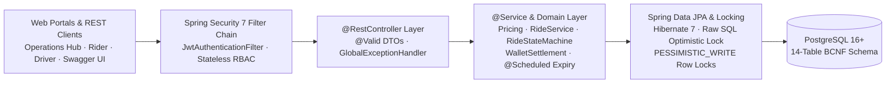
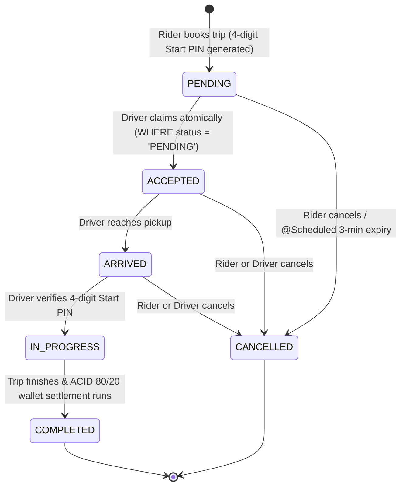

# ⚡ RideVault — Dynamic Ride Booking & Wallet Settlement Platform

[](https://www.oracle.com/java/)
[](https://spring.io/projects/spring-boot)
[](https://spring.io/projects/spring-framework)
[](https://spring.io/projects/spring-security)
[](https://www.postgresql.org/)
[](https://springdoc.org/)

**RideVault** is a production-style dynamic ride-hailing and driver wallet settlement backend built with **Java 21, Spring Boot 4, Spring Framework 7, Spring Security 7, Hibernate 7 (Spring Data JPA), and PostgreSQL**. It models an end-to-end trip lifecycle—combining GPS Haversine fare & surge pricing, concurrency-safe ride claiming without double-booking, 4-digit boarding Start PIN verification, a guarded 6-state machine with immutable audit logs, and `@Transactional` 80/20 driver wallet settlements.

---

## 🏗️ 3-Tier System Architecture



---

## 🎯 Core Engineering Highlights

| Engineering Pillar | How It Works | Key Source Files |
| :--- | :--- | :--- |
| **JWT Auth & Refresh Rotation** | BCrypt password hashing, stateless JWT access tokens (`jjwt 0.13.0`), SHA-256 refresh token rotation (`/refresh`, `/logout`) with replay revocation, Jakarta `@Valid` DTO validation, and RBAC (`ROLE_RIDER`, `ROLE_DRIVER`, `ROLE_ADMIN`) + participant ownership checks. | [`SecurityConfig.java`](./ridevault-backend/src/main/java/com/ridevault/config/SecurityConfig.java), [`JwtService.java`](./ridevault-backend/src/main/java/com/ridevault/config/JwtService.java), [`AuthService.java`](./ridevault-backend/src/main/java/com/ridevault/service/AuthService.java) |
| **Concurrency-Safe Claiming** | Prevents double-booking race conditions when competing drivers accept the same trip using atomic conditional SQL (`UPDATE rides ... WHERE ride_id = ? AND status = 'PENDING'`) indexed by `idx_rides_pending`. Returns `409 Conflict` to losing drivers. | [`RideRepository.java`](./ridevault-backend/src/main/java/com/ridevault/repository/RideRepository.java), [`RideService.java`](./ridevault-backend/src/main/java/com/ridevault/service/RideService.java) |
| **6-State FSM & Start PIN** | Strictly enforces `PENDING → ACCEPTED → ARRIVED → IN_PROGRESS → COMPLETED / CANCELLED` transitions, requires matching the rider's 4-digit `start_pin` before starting a trip, and persists immutable `ride_status_logs` rows on every change. | [`RideStateMachine.java`](./ridevault-backend/src/main/java/com/ridevault/service/statemachine/RideStateMachine.java) |
| **ACID 80/20 Wallet Ledger** | Executes `@Transactional(rollbackFor = Exception.class)` 80% driver payout / 20% platform commission settlements and withdrawals protected by `PESSIMISTIC_WRITE` row locks (`SELECT ... FOR UPDATE`) and double-entry `wallet_transactions`. | [`WalletSettlementService.java`](./ridevault-backend/src/main/java/com/ridevault/service/WalletSettlementService.java), [`WalletRepository.java`](./ridevault-backend/src/main/java/com/ridevault/repository/WalletRepository.java) |
| **Spatial Surge & Auto-Expiry** | Computes spherical Haversine distance (6371 km), real-time demand/supply surge + geographic `surge_zones` multipliers (capped at `3.5x`), and runs a `@Scheduled` job every 30s to auto-cancel stale `PENDING` rides older than 3 minutes. | [`PricingService.java`](./ridevault-backend/src/main/java/com/ridevault/service/PricingService.java), [`RideExpiryScheduler.java`](./ridevault-backend/src/main/java/com/ridevault/service/RideExpiryScheduler.java) |
| **14-Table BCNF PostgreSQL** | Normalized relational schema with shared-PK `@MapsId` subtypes (`users` → `riders` / `drivers`), vehicle fleet & compliance (`vehicle_documents`), financial ledger, `refresh_tokens`, and 1–5★ `ride_ratings`. | [`database/DDL.sql`](./database/DDL.sql), [`database/DQL.sql`](./database/DQL.sql) |

---

## 🔄 Ride Lifecycle State Machine



Every transition validates against the directed transition graph in [`RideStateMachine.java`](./ridevault-backend/src/main/java/com/ridevault/service/statemachine/RideStateMachine.java) and writes an audit record into `ride_status_logs`.

---

## 🗄️ 14-Table BCNF Database & Diagrams

The [`database/`](./database) directory provides standalone PostgreSQL scripts and visual architecture diagrams ready for inspection or direct execution:

- [`DDL.sql`](./database/DDL.sql) — 14 BCNF tables, foreign keys, check constraints, and composite/partial indexes (`idx_rides_pending`)
- [`DataInsertion.sql`](./database/DataInsertion.sql) — Idempotent seed & sample dataset across all 14 tables with synchronized `SERIAL` sequences
- [`DQL.sql`](./database/DQL.sql) — 15 analytical PostgreSQL queries (driver earnings leaderboard, double-entry wallet ledger reconciliation, compliance expiry alerts, rating audits, state transition latency)
- [`RelationalDiagram.pdf`](./database/RelationalDiagram.pdf) — Full Workbench-style Crow's-Foot schema diagram (`PK`/`FK` keys, column types, indexes)
- [`database/README.md`](./database/README.md) — Complete schema dictionary and `psql` quick guide


---

## 🧪 Automated Integration Test Suite

All tests execute against live **PostgreSQL** (`Spring Boot 4` test starters + `MockMvc` + `ExecutorService`):

| Test Class | What It Verifies | Source |
| :--- | :--- | :--- |
| **End-to-End Boot 4 Smoke** | Public hub overview, OpenAPI JSON, BCrypt register/login, SHA-256 refresh token rotation & replay block (`401`), `@MapsId` rider profile update, booking, Start PIN mismatch (`400`) & match, 80/20 settlement, 5★ rating update, audit timeline, pagination, and logout. | [`RideVaultSpringBoot4SmokeTest.java`](./ridevault-backend/src/test/java/com/ridevault/api/RideVaultSpringBoot4SmokeTest.java) |
| **10-Thread Concurrency Race** | Fires simultaneous accept requests across competing threads on one `PENDING` ride—proving only 1 driver succeeds while competing threads receive `RideAlreadyClaimedException`. | [`RideConcurrencyTest.java`](./ridevault-backend/src/test/java/com/ridevault/concurrency/RideConcurrencyTest.java) |
| **ACID Settlement Rollback** | Simulates a runtime crash mid-settlement to prove `@Transactional(rollbackFor = Exception.class)` rolls back wallet balance updates and ledger inserts together with zero drift. | [`WalletSettlementRollbackTest.java`](./ridevault-backend/src/test/java/com/ridevault/settlement/WalletSettlementRollbackTest.java) |

---

## 📁 Repository Structure

```text
RideVault-Backend/
├── database/                                  # Standalone 14-table BCNF SQL scripts & ER diagrams
│   ├── DDL.sql                                # Complete PostgreSQL DDL (tables, constraints, indexes)
│   ├── DataInsertion.sql                      # Full idempotent seed dataset & sequence synchronization
│   ├── DQL.sql                                # 15 analytical PostgreSQL queries
│   ├── ERD.jpg                                # Chen-notation Entity-Relationship Diagram
│   ├── RelationalDiagram.pdf                  # Crow's-Foot Workbench relational diagram
│   └── README.md                              # Schema dictionary & psql guide
├── ridevault-backend/                         # Spring Boot 4 / Spring 7 REST API + Web Portals
│   ├── pom.xml                                # Java 21, Spring Boot 4.1.2, JJWT 0.13.0, SpringDoc 3.2.0
│   ├── README.md                              # Full REST API endpoint reference
│   ├── RideVault.postman_collection.json      # Postman v2.1 API collection (Spring Boot 4 + JWT)
│   └── src/
│       ├── main/java/com/ridevault/
│       │   ├── config/                        # SecurityConfig, JwtService, JwtAuthenticationFilter, OpenAPI, WebConfig
│       │   ├── controller/                    # Auth, Ride, Rider, Driver, Wallet, Admin, Hub REST controllers
│       │   ├── dto/                           # Jakarta @Valid request & standardized response DTOs
│       │   ├── entity/                        # 14 BCNF JPA entities & enums
│       │   ├── exception/                     # Centralized @RestControllerAdvice error mapping
│       │   ├── repository/                    # 14 Spring Data JPA repositories (optimistic & pessimistic locks)
│       │   └── service/                       # Pricing, Ride, WalletSettlement, @Scheduled expiry & RideStateMachine
│       ├── main/resources/
│       │   ├── application.yml                # Env-var safe defaults + optional local YAML import
│       │   ├── application-local.yml.example  # Local PostgreSQL & JWT secret template
│       │   ├── schema.sql                     # Auto-initialized PostgreSQL DDL
│       │   └── static/                        # Operations Hub (index.html), Rider & Driver Portals
│       └── test/java/com/ridevault/           # E2E Smoke, Multi-Thread Concurrency & ACID Rollback tests
├── .gitignore                                 # Excludes target/, IDE files & local secret configs
└── README.md
```

---

## 🚀 Quick Start (Local PostgreSQL + Maven)

### Prerequisites
- **Java 21** (JDK 21+)
- **Maven 3.9+**
- **PostgreSQL 16+** running locally on `localhost:5432`

### 1. Clone the Repository
```bash
git clone https://github.com/devgorasiya07/RideVault-Backend.git
cd RideVault-Backend
```

### 2. Initialize PostgreSQL Database
Create the `ridevault` database and apply the 14-table schema and sample data:
```bash
createdb -U postgres ridevault
psql -U postgres -d ridevault -f database/DDL.sql
psql -U postgres -d ridevault -f database/DataInsertion.sql
```

### 3. Configure Local Credentials
Copy [`application-local.yml.example`](./ridevault-backend/src/main/resources/application-local.yml.example) to `ridevault-backend/src/main/resources/application-local.yml` (gitignored) and set your PostgreSQL password and 256-bit Base64 JWT secret:
```yaml
spring:
  datasource:
    url: jdbc:postgresql://localhost:5432/ridevault
    username: postgres
    password: your_local_postgres_password

application:
  security:
    jwt:
      secret-key: replace-with-your-256-bit-base64-jwt-secret
```

### 4. Run Tests & Start the Server
```bash
cd ridevault-backend
mvn test               # Runs E2E Smoke, 10-Thread Concurrency & ACID Rollback tests
mvn spring-boot:run    # Starts embedded Tomcat on http://localhost:8080
```

### 5. Explore Live Web Portals & API Docs
| Interface | URL / Resource | Purpose |
| :--- | :--- | :--- |
| **Operations Hub** | `http://localhost:8080/` | Live PostgreSQL telemetry, fleet metrics & active surge zones |
| **Rider Portal** | `http://localhost:8080/rider.html` | Route fare estimation, booking, Start PIN display, SOS profile & 5★ rating |
| **Driver Portal** | `http://localhost:8080/driver.html` | Online/Offline availability, atomic ride claiming, Start PIN entry & wallet payouts |
| **Swagger / OpenAPI UI** | `http://localhost:8080/swagger-ui.html` | Interactive OpenAPI 3 endpoint explorer with JWT Bearer auth |
| **Postman Collection** | [`RideVault.postman_collection.json`](./ridevault-backend/RideVault.postman_collection.json) | Pre-configured requests with automatic JWT token capture |

See [`ridevault-backend/README.md`](./ridevault-backend/README.md) for the complete REST API endpoint reference.
