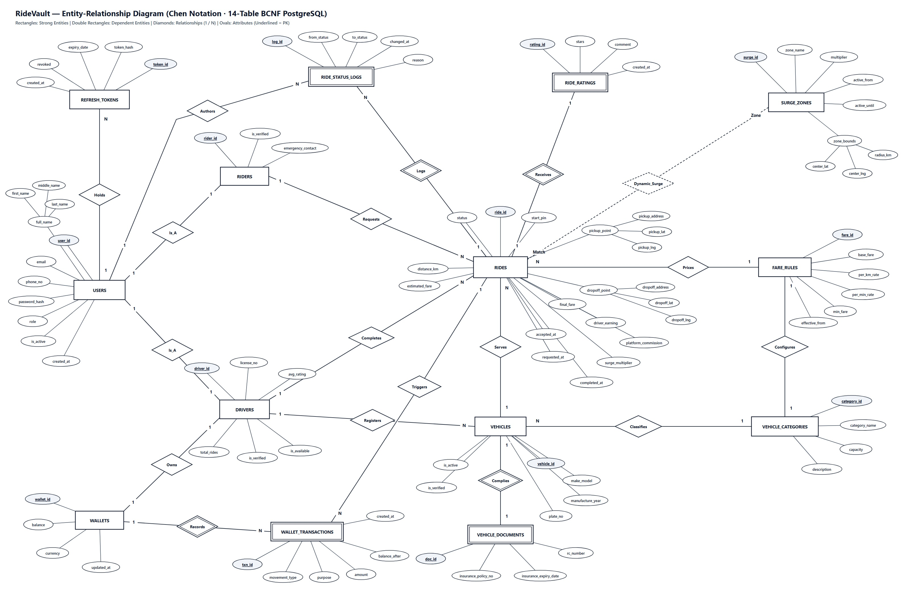

# ⚡ RideVault — Dynamic Ride Booking & Wallet Settlement Platform

[](https://www.oracle.com/java/)
[](https://spring.io/projects/spring-boot)
[](https://spring.io/projects/spring-framework)
[](https://spring.io/projects/spring-security)
[](https://www.postgresql.org/)

**RideVault** is a dynamic ride-hailing and driver wallet settlement backend built with **Java 21, Spring Boot 4, Spring Framework 7, Spring Security 7, Spring Data JPA (Hibernate 7), and PostgreSQL**. It models a production-style trip lifecycle—from rider fare estimation and concurrency-safe ride claiming to 4-digit boarding Start PIN verification and `@Transactional` 80/20 driver wallet settlements.

---

## 🎯 Core Engineering Highlights

| Pillar | What Was Built | Key Files |
| :--- | :--- | :--- |
| **Auth & RBAC Security** | BCrypt password hashing, stateless JWT access tokens (`jjwt`), SHA-256 refresh-token rotation with replay revocation, Jakarta `@Valid` DTO validation, and role isolation (`ROLE_RIDER`, `ROLE_DRIVER`, `ROLE_ADMIN`). | [`SecurityConfig.java`](./ridevault-backend/src/main/java/com/ridevault/config/SecurityConfig.java), [`JwtService.java`](./ridevault-backend/src/main/java/com/ridevault/config/JwtService.java), [`AuthService.java`](./ridevault-backend/src/main/java/com/ridevault/service/AuthService.java) |
| **14-Table BCNF PostgreSQL** | Normalized schema separating `users`, `riders`, `drivers` (shared PK), `vehicles`, `vehicle_categories`, `vehicle_documents`, `fare_rules`, `surge_zones`, `rides`, `ride_status_logs`, `wallets`, `wallet_transactions`, `refresh_tokens`, and `ride_ratings`, with partial indexing (`idx_rides_pending`). | [`database/DDL.sql`](./database/DDL.sql), [`database/DQL.sql`](./database/DQL.sql) |
| **Concurrency-Safe Claiming** | Prevents double-booking race conditions using raw SQL optimistic locking (`UPDATE rides ... WHERE ride_id = ? AND status = 'PENDING'`) verified across 10 concurrent threads. | [`RideRepository.java`](./ridevault-backend/src/main/java/com/ridevault/repository/RideRepository.java), [`RideConcurrencyTest.java`](./ridevault-backend/src/test/java/com/ridevault/concurrency/RideConcurrencyTest.java) |
| **Ride Lifecycle & Dynamic Pricing** | 6-state machine (`PENDING → ACCEPTED → ARRIVED → IN_PROGRESS → COMPLETED / CANCELLED`), 4-digit boarding Start PIN check, `@Scheduled` 3-minute auto-expiry, Haversine spatial surge pricing, audit timelines, and 5★ rating aggregation. | [`RideStateMachine.java`](./ridevault-backend/src/main/java/com/ridevault/service/statemachine/RideStateMachine.java), [`RideService.java`](./ridevault-backend/src/main/java/com/ridevault/service/RideService.java), [`PricingService.java`](./ridevault-backend/src/main/java/com/ridevault/service/PricingService.java), [`RideExpiryScheduler.java`](./ridevault-backend/src/main/java/com/ridevault/service/RideExpiryScheduler.java) |
| **ACID Wallet Settlements** | `@Transactional(rollbackFor = Exception.class)` 80/20 driver/platform payouts and withdrawals protected by `PESSIMISTIC_WRITE` locks and a double-entry `wallet_transactions` ledger, verified by runtime crash rollback tests. | [`WalletSettlementService.java`](./ridevault-backend/src/main/java/com/ridevault/service/WalletSettlementService.java), [`WalletSettlementRollbackTest.java`](./ridevault-backend/src/test/java/com/ridevault/settlement/WalletSettlementRollbackTest.java) |

---

## 🗄️ Database Design & Entity-Relationship Diagram

The [`database/`](./database) directory ships complete, standalone SQL scripts and diagrams for PostgreSQL:
- [`DDL.sql`](./database/DDL.sql) — 14 BCNF tables, foreign keys, check constraints, and partial/composite indexes
- [`DataInsertion.sql`](./database/DataInsertion.sql) — Idempotent sample & seed dataset across all 14 tables with synchronized `SERIAL` sequences
- [`DQL.sql`](./database/DQL.sql) — 15 analytical PostgreSQL queries (driver earnings leaderboard, double-entry ledger reconciliation, insurance expiry alerts, low-rating audits, transition latency)
- [`RelationalDiagram.pdf`](./database/RelationalDiagram.pdf) — Full Workbench-style Crow's-Foot schema diagram (`PK`/`FK` keys, column types, indexes)



---

## 📁 Repository Structure

```text
ridevault-cli/
├── database/                        # Standalone PostgreSQL 14-table BCNF SQL scripts & diagrams
│   ├── DDL.sql                      # Complete DDL (14 tables, constraints, indexes)
│   ├── DataInsertion.sql            # Full idempotent seed & sample dataset (all 14 tables)
│   ├── DQL.sql                      # 15 analytical PostgreSQL queries
│   ├── ERD.jpg                      # Chen-notation Entity-Relationship Diagram
│   ├── RelationalDiagram.pdf        # Crow's-Foot Workbench relational diagram
│   └── README.md                    # Database schema & Mermaid diagram docs
├── ridevault-backend/               # Spring Boot 4 / Spring 7 REST API + Embedded Web Portals
│   ├── pom.xml
│   ├── README.md                    # Full REST API endpoint reference & test commands
│   ├── RideVault.postman_collection.json
│   └── src/
│       ├── main/java/com/ridevault/
│       │   ├── config/              # SecurityConfig, JwtService, JwtAuthenticationFilter, OpenAPI, WebConfig
│       │   ├── controller/          # Auth, Ride, Rider, Driver, Wallet, Admin, Hub REST controllers
│       │   ├── dto/                 # Validated request & response DTOs (incl. PageResponse)
│       │   ├── entity/              # 14 BCNF JPA entities & enums
│       │   ├── exception/           # Centralized @RestControllerAdvice exception mapping
│       │   ├── repository/          # 14 Spring Data JPA repositories (optimistic & pessimistic locks)
│       │   └── service/             # Business services, RideStateMachine, PricingService, @Scheduled expiry
│       ├── main/resources/
│       │   ├── application.yml      # Safe config with env-var placeholders + optional local import
│       │   ├── application-local.yml.example
│       │   ├── schema.sql           # Auto-initialized SQL schema for Spring Boot startup
│       │   └── static/              # Operations Hub (index.html), Rider Portal, Driver Portal
│       └── test/java/com/ridevault/ # E2E Smoke, 10-thread Concurrency & ACID Rollback integration tests
├── ridevault-cli/                   # Legacy Core Java + JDBC console prototype
├── docker-compose.yml               # One-command PostgreSQL 16 setup loading database/ scripts
├── .gitignore                       # Excludes target/, bin/, .idea/, and local secrets
└── README.md
```

---

## 🚀 Quick Start (Run Locally)

### 1. Start PostgreSQL
Run PostgreSQL automatically with Docker Compose (initializes `ridevault` from `database/DDL.sql` and `database/DataInsertion.sql`):

```bash
docker compose up -d
```

Or create the database on a local PostgreSQL instance:

```bash
createdb -U postgres ridevault
psql -U postgres -d ridevault -f database/DDL.sql
psql -U postgres -d ridevault -f database/DataInsertion.sql
```

Then copy [`application-local.yml.example`](./ridevault-backend/src/main/resources/application-local.yml.example) to `ridevault-backend/src/main/resources/application-local.yml` (gitignored) and set your PostgreSQL password.

### 2. Run the Spring Boot Backend & Tests

```bash
cd ridevault-backend
mvn test               # Runs E2E Smoke, 10-Thread Concurrency & ACID Rollback tests
mvn spring-boot:run    # Starts embedded Tomcat on http://localhost:8080
```

### 3. Explore Portals & API Docs
- **Operations Hub:** `http://localhost:8080/`
- **Rider Portal:** `http://localhost:8080/rider.html`
- **Driver Portal:** `http://localhost:8080/driver.html`
- **OpenAPI / Swagger UI:** `http://localhost:8080/swagger-ui.html`

See [`ridevault-backend/README.md`](./ridevault-backend/README.md) for the complete REST API endpoint reference.
