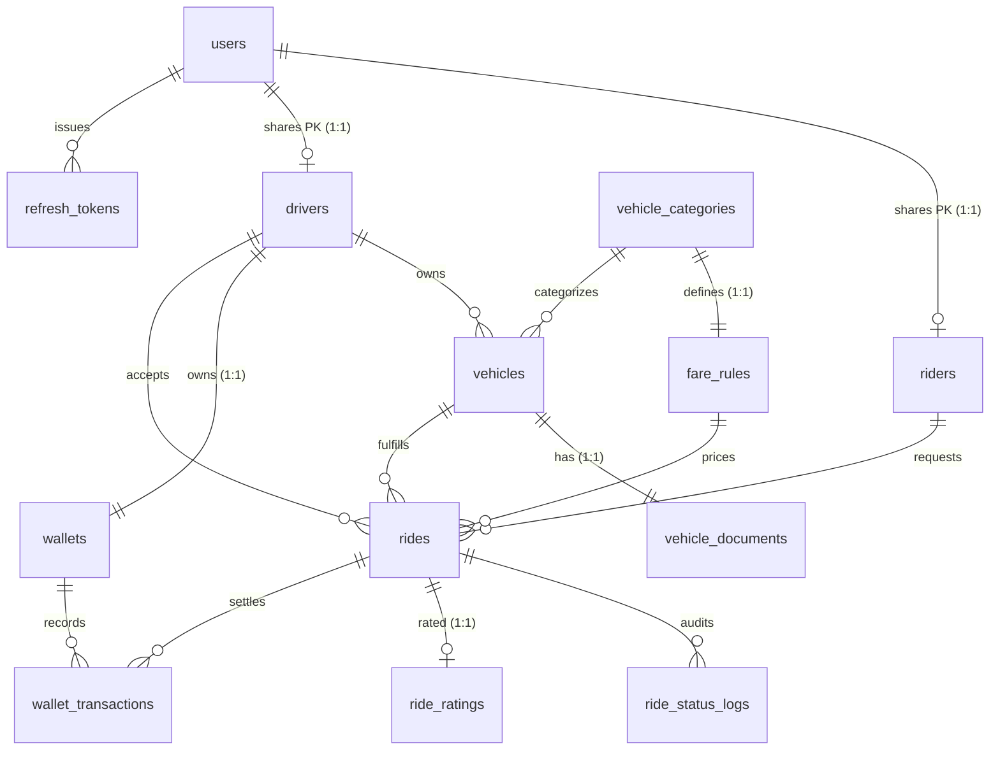

# 🗄️ RideVault Database Design (14-Table BCNF PostgreSQL)

This folder contains the complete **PostgreSQL 16+** 14-table BCNF database artifacts for RideVault, structured for direct SQL execution and GitHub documentation:

| File | Purpose |
| --- | --- |
| `DDL.sql` | Complete Data Definition Language (14 BCNF tables, foreign keys, check constraints, and partial/composite indexes) |
| `DataInsertion.sql` | Idempotent seed & sample dataset across all 14 tables (categories, tariffs, Gandhinagar surge zones, users, vehicles, rides, wallets, ledger txns & ratings) |
| `DQL.sql` | 15 analytical PostgreSQL queries covering revenue, driver leaderboards, loyal riders, double-entry reconciliation, compliance alerts, ratings & token audit |
| `ERD.jpg` | High-resolution Chen-notation Entity-Relationship Diagram (entities, diamonds, cardinalities & composite attributes) |
| `RelationalDiagram.pdf` | Workbench-style Crow's-Foot Relational Schema Diagram detailing PK/FK keys, nullability, data types & indexes |

> Note: Spring Boot also ships an auto-initialized copy at `ridevault-backend/src/main/resources/schema.sql`. Keeping this folder at the repository root allows immediate inspection, manual `psql` setup, or Docker initialization.

---

## Entity-Relationship Diagram



---

## 14-Table BCNF Summary

| # | Table | Primary Key | Candidate / Unique Keys | Purpose |
|---|---|---|---|---|
| 1 | `users` | `user_id` | `email`, `phone_no` | Base identity, BCrypt hash, RBAC role (`ROLE_RIDER`, `ROLE_DRIVER`, `ROLE_ADMIN`) |
| 2 | `riders` | `rider_id` | `rider_id` (`@MapsId`) | Rider verification & SOS `emergency_contact` |
| 3 | `drivers` | `driver_id` | `driver_id`, `license_no` | License, live `avg_rating`, `total_rides`, Online/Offline `is_available` |
| 4 | `refresh_tokens` | `token_id` | `token_hash` (SHA-256) | Stateful refresh token rotation & logout revocation |
| 5 | `vehicle_categories` | `category_id` | `category_name` | Master catalog (`MINI`, `SEDAN`, `SUV`, `PREMIUM`, `AUTO`, `BIKE`) |
| 6 | `fare_rules` | `fare_id` | `category_id` | Base fare, per-km, per-minute, and minimum tariff per category |
| 7 | `vehicles` | `vehicle_id` | `plate_no` | Fleet vehicles linked to driver & category |
| 8 | `vehicle_documents` | `doc_id` | `vehicle_id` | Insurance policy number, expiry date, RC compliance |
| 9 | `surge_zones` | `surge_id` | `zone_name` | Geographic surge zones (`center_lat`, `center_lng`, `radius_km`, `multiplier`) |
| 10 | `rides` | `ride_id` | — | Central trip ledger with `status` check constraint & 4-digit `start_pin` |
| 11 | `ride_status_logs` | `log_id` | — | Immutable state-machine audit trail (`from_status → to_status`) |
| 12 | `wallets` | `wallet_id` | `driver_id` | Driver wallet balance locked via `PESSIMISTIC_WRITE` during settlement |
| 13 | `wallet_transactions` | `txn_id` | — | Double-entry `CREDIT` / `DEBIT` financial ledger |
| 14 | `ride_ratings` | `rating_id` | `ride_id` | 1–5 star post-ride driver rating & review (strictly BCNF) |

---

## Quick Setup via `psql`

```bash
# 1. Create the database
createdb -U postgres ridevault

# 2. Apply schema & seed data
psql -U postgres -d ridevault -f database/DDL.sql
psql -U postgres -d ridevault -f database/DataInsertion.sql

# 3. (Optional) Run analytical queries
psql -U postgres -d ridevault -f database/DQL.sql
```

Or launch PostgreSQL automatically with Docker Compose from the repository root:

```bash
docker compose up -d
```
